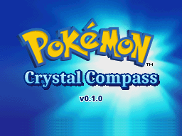
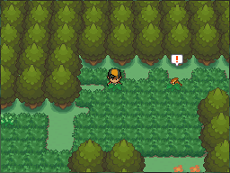
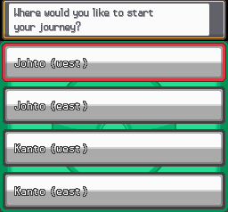
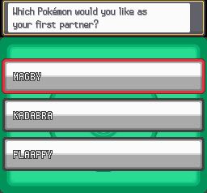
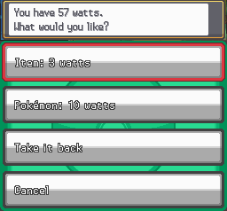
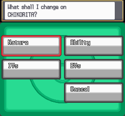

# Pokémon Crystal Compass

**An open-world hack of Pokémon HeartGold, inspired by Pokémon Crystal
Clear.** Start in any town in Johto or Kanto, take on all 16 Gyms in any
order, and catch every one of the 493 Pokémon, no trading needed.

Crystal Compass is built from the [pret pokeheartgold](https://github.com/pret/pokeheartgold)
decompilation and shared only as a patch: there's no ROM here or in the
patch, so you apply it to your own copy of HeartGold.

  
  

  
  

  
  

**Version 0.1.0** · [Patch your ROM in the browser](https://keanfreeman.github.io/pokemon-crystal-compass/) ·
[Download the patch](https://github.com/keanfreeman/pokemon-crystal-compass/releases/latest) ·
[Report a bug](https://github.com/keanfreeman/pokemon-crystal-compass/issues/new/choose)

## What's new

- **Go anywhere, in any order.** No story roadblocks. Gym Leaders' teams
  scale with how many badges you have, and the League opens with any eight.
- **Start anywhere.** Pick your starter from any region (Kanto, Johto, Hoenn
  or Sinnoh) and your first town in Johto or Kanto. The other eleven
  starters come later, from Professors Elm and Oak and from Steven.
- **Wild Pokémon you can see.** They wander the grass, caves and water and
  come after you when they spot you. Prefer random encounters? Switch any
  time.
- **Catch all 493 without trading.** SoulSilver's Pokémon, trade
  evolutions, Pokéwalker species and the event legendaries are all in the
  game.
- **A Pokéwalker in the game.** The Day-Care man on Route 34 takes a
  Pokémon on Pokéwalker walks: it earns Exp. as you walk, and the watts
  buy items and Pokémon from the course, including the Pokéwalker-only
  species.
- **Keep your team as it is.** The HM Kit uses any HM in your Bag, so no
  Pokémon has to give up a move slot to Cut or Strength.
- **Less waiting.** Instant text, faster battles and healing, reusable TMs,
  fishing that always bites, a Repel that offers another when it runs out.
- **Optional randomizer and hard mode.** The randomizer is chosen when you
  start; hard mode can be switched on or off any time.

## How to install

You need your own legally obtained **Pokémon HeartGold (USA)** ROM,
unmodified. The patch won't work on other regions, SoulSilver, or a
trimmed ROM.

1. Open the **[web patcher](https://keanfreeman.github.io/pokemon-crystal-compass/)**, choose your ROM and click *Patch
   and download*. It checks the ROM for you, and nothing is uploaded.

   *Or* download `Pokemon-Crystal-Compass-v0.1.0.bps` from the
   [latest release](https://github.com/keanfreeman/pokemon-crystal-compass/releases/latest) and apply
   it with [Flips](https://github.com/Alcaro/Flips) or another BPS patcher.
2. Play the patched ROM in [melonDS](https://melonds.kuribo64.net/) or on a
   DS with a flashcart.
3. Start a **new game**. Saves from HeartGold or from older versions of
   Crystal Compass aren't supported.

Clean ROM SHA-1: `4fcded0e2713dc03929845de631d0932ea2b5a37` 
Patched ROM SHA-1: `6f3b5144e071191a67e4b401d90083cc304df90d`

## Questions

- **Something's broken?** [Open an issue](https://github.com/keanfreeman/pokemon-crystal-compass/issues/new/choose)
  with the version, your emulator and, if you can, your save file.

## Everything that's different (spoilers)

The full list: every change, and where to find it

### Starting out
- **The new game** asks a few questions after naming: play with the
  randomizer or not, wandering wild Pokémon or random encounters, your
  starter (from Kanto, Johto, Hoenn or Sinnoh), and your start town (any in
  Johto or Kanto except Cinnabar). You wake up there.
- **You start with:** the Pokédex (National Pokédex included), Pokégear
  with the Map and Radio cards, Running Shoes, the HM Kit, the S.S.
  Ticket, the Magnet Train Pass, the Apricorn Box, the Vs. Recorder, 5
  Poké Balls and 5 Potions. Mass outbreaks are on from day one.
- **No story roadblocks.** Take on the 16 Gyms in any order; the Pokémon
  League opens with any eight badges. Mt. Silver opens once you've beaten
  Blue.
- **Leaders scale:** each Gym Leader brings a team to match how many badges
  you have, and their ace knows a signature move.
- **Saves:** start a new game. Saves from HeartGold or older versions of
  Crystal Compass aren't supported.

### The other starters
- **Prof. Elm** (New Bark Lab) has the Johto and Sinnoh starters, **Prof.
  Oak** (Pallet Town Lab) the Kanto ones, and **Steven** (Silph Co. lobby,
  Saffron) the Hoenn ones.
- Each gives one starter per region right away, a second after your first
  League win, and the last after your second. Your new-game starter isn't
  offered again.
- With a full party they go to your PC.

### Events, changed or open early
- **Skipped:** the Cherrygrove Guide Gent's tour, Lyra's catching lesson on
  Route 29 (Poké Balls are in the Marts from the start), the Radio Card
  quiz, and Oak's second Pokédex at Mr. Pokémon's.
- **Still there to play:** Elm's errand to Mr. Pokémon and the rival
  after it, the Slowpoke Well, the Lighthouse and Jasmine's medicine, the
  Lake of Rage, the Radio Tower takeover, the Power Plant's stolen part,
  Blue on Cinnabar, and Misty's date on Route 25 (once you have her badge).
- **Out of the way:** Sudowoodo steps off the Route 36 path (it's still
  there to battle), Snorlax on Route 11 wakes when you talk to it (no Poké
  Flute needed), and Route 19's construction is finished.
- **Gates removed:** the Route 32 man who sends you back, the Route 43
  toll, the Route 44 RageCandyBar man, the National Park construction, the
  Route 40 surfer, the Ecruteak Gym's old man, and Route 22's badge check
  into Kanto.
- **Jasmine** waits in the Olivine Gym from the start, and **Clair** gives
  the Rising Badge when you beat her (the Dragon's Den is still there).
- **The Magnet Train** runs before the Power Plant is fixed.
- **Beating Red** before the League doesn't count as clearing the game.

### Getting around
- **The HM Kit** (Key Items): with an HM in your Bag, its move works in the
  field without any Pokémon knowing it, and badges aren't needed. Press A
  at a tree, rock, boulder, the water, a waterfall, whirlpool or rocky wall
  as usual. Use the kit (or register it to Y) to Fly once you have HM02.
- **Flying service:** fliers in the Goldenrod and Saffron Magnet Train
  stations and by Cianwood's Pokémon Center fly you to any town for $500.
  Short of money in Cianwood, the flight is free.

### Wild Pokémon
- **No random encounters** in grass, caves or water: wild Pokémon wander
  around where you can see them, shinies included. Step next to one to
  battle it.
- One that spots you shows a "!" and comes after you at a walk. Run and you
  can get away; it gives up after a dozen steps. Ones in the water only
  battle you while you're surfing.
- Once battled, caught or fled from, it's gone. The others leave you alone
  until you take a step.
- They're the same Pokémon you'd have met at random: time of day, swarms,
  the radio's Sounds, Repel and your lead's ability all still count.
- They wander the **Safari Zone** and the **Bug-Catching Contest** too. The
  Contest uses the wider post-game selection of bugs (which ones depends
  on the day), at levels for your badges.
- **Prefer random encounters?** Choose them at the start, or switch any time
  with the attendant by the door of any Pokémon Center.
- Fishing, Headbutt, Rock Smash, Sweet Scent and the roaming beasts work as
  before.

### Legendaries and event Pokémon
Each of these stands somewhere in Johto or Kanto once you've **heard its
rumor** from the reporter in the Goldenrod Global Terminal (first floor,
right of the door). Talk to it to battle. If it gets away or faints, it's
back once you leave and return, until you catch it. Its level follows your
badges, but never drops below its usual level.
- **Mew:** Vermilion City, the far end of the pier (where the truck was).
- **Celebi:** Ilex Forest, by the shrine, in the morning.
- **Jirachi:** Mt. Silver's summit, at night.
- **Deoxys:** Mt. Moon Square, on Monday nights.
- **Regirock:** Rock Tunnel, B1F. **Regice:** Ice Path, B3F. **Registeel:**
  Mt. Mortar, B1F.
- **Regigigas:** the Dragon's Den, with Regirock, Regice and Registeel in
  your party.
- **Uxie:** Ruins of Alph, by the pond.
- **Mesprit:** Lake of Rage, in the daytime. **Cresselia:** Lake of Rage, on
  the water, at night.
- **Azelf:** Mt. Silver, by the water outside.
- **Heatran:** Cinnabar Island.
- **Rotom:** the Kanto Power Plant.
- **Darkrai:** your bedroom in New Bark, at night.
- **Manaphy:** Route 41, out on the sea. Leave it at the Day-Care with a
  Ditto for Phione Eggs.
- **Shaymin:** Route 2, in the daytime.
- **Arceus:** Ruins of Alph, once you've caught every legendary above.
- **Spiky-eared Pichu:** after its rumor, examine the Ilex Forest shrine
  with any Pichu, Pikachu or Raichu in the lead.
- Celebi and Arceus count as event Pokémon, so HeartGold's Ilex Forest
  shrine and Ruins of Alph events work with them.

### Catching everything else
- **All 493** can be caught in one game without trading.
- **SoulSilver's Pokémon** live here too, usually on the same routes as
  their HeartGold counterparts: Vulpix, Meowth, Ledyba, Teddiursa,
  Delibird, Skarmory and more. Gulpin (Route 3) and Mawile (Route 9) are
  rare finds in the grass.
- **Trade evolutions:** the gentleman by the door of the Goldenrod Global
  Terminal (first floor, left) trades your Pokémon away and straight back,
  so it evolves (with its held item, if it needs one). Feebas becomes
  Milotic this way. An Everstone still stops it.
- **Evolutions that need a special place:** level up Magneton or Nosepass
  at the Kanto Power Plant or on Route 10 outside it (Magnezone,
  Probopass), an Eevee in Ilex Forest (Leafeon) or the Ice Path (Glaceon).
  An Eevee with high friendship still becomes Espeon or Umbreon first.
- **Armor and Skull Fossils** (Shieldon, Cranidos): the researcher in the
  Pewter Museum gives you both once the museum has revived three of your
  fossils.
- **The Hoenn and Sinnoh Sounds** play on the Pokégear's Pokémon Music
  channel every day, from the start; tune in again to change the song.
  While one plays, Pokémon from that region turn up in the grass: Hoenn's
  Plusle, Minun, Whismur and Absol; Sinnoh's Shinx, Buizel and Bronzor,
  plus Glameow on Johto routes, Stunky on Kanto routes and Drifloon on
  Kanto's water routes.

### Walks: a Pokéwalker in the game (Day-Care, Route 34)
- Ask the Day-Care man for **Walks** and send one Pokémon on any course you've
  opened, as on the Pokéwalker. Two are open at first; walking more opens
  the rest, up to all 27.
- It earns 1 Exp. per step you take, and a watt every 40 steps.
- Spend watts with him: 3 to search for an item, 10 for a Pokémon from the
  course (it goes to your party or the PC). Rarer finds need more steps on
  that walk. This is where the Pokéwalker-only species come from:
  Kecleon, Skitty, Castform, Tropius, Snorunt, Snover, Spiritomb, Wailmer,
  Carvanha, Feebas, Finneon, Shellos and more.
- Take it back any time, with its Exp. and the moves it learned.

### Lottery Corner (Goldenrod Radio Tower)
- Each day the clerk names a Pokémon you haven't caught yet and where to
  find it. Catch one that day and come back for a prize. It's far more
  likely than usual to be shiny.
- Prizes grow with your streak of days in a row: Rare Candies, PP Ups and
  evolution stones, then trade-evolution items (from day 3), then held items
  like Leftovers, Life Orb and the Choice items (from day 5). Every 7th day:
  a Master Ball.

### Battles and levels
- Wild Pokémon, Trainers and set encounters (Snorlax, the Electrode, the
  Red Gyarados) scale with your badges, both up and down.
- The Elite Four and Lance have themed six-Pokémon teams, and stronger
  ones after your first League win.
- **Hard mode** (the attendant by the door of any Pokémon Center): Gym
  Leaders bring an extra Pokémon and a higher-level ace holding a Sitrus
  Berry; the Elite Four, Lance and Red are 4 levels higher; other Trainers
  are 3 levels higher with stronger Pokémon. Switch it off any time.

### The Battle Frontier's tutor house
- The three move tutors charge half the BP.
- **The tuner** (after two League wins) changes a Pokémon's nature, its
  ability (to its species' other one), its IVs (any or all to 31, one to 0,
  or a Hidden Power type at full power) and its EVs, for BP or money.
  Gender and shininess stay the same.

### Faster play
- **Text** shows each page at once (the Fast setting, the default).
- Faster HP and Exp. bars, and faster healing at the Pokémon Center.
- **TMs** are never used up.
- **Fishing:** every cast gets a bite where there's something to catch.
- **Repel:** when one wears off, you're offered another of the same kind.
- Trainers call for rematches half as often.

### Randomizer
- Chosen at the start. Wild, Trainer, set-encounter, starter, gift and Egg
  Pokémon are swapped for others of similar strength. Legendaries stay as
  they are.
- Everything above still works, on whatever species you get.

## Credits

- Made by [keanfreeman](https://github.com/keanfreeman).
- Built on the [pret pokeheartgold](https://github.com/pret/pokeheartgold)
  decompilation.
- Inspired by the open world of Pokémon Crystal Clear.
- Tested with melonDS.

Pokémon is © Nintendo, Game Freak and Creatures. Crystal Compass is a free,
non-commercial fan project and isn't affiliated with them. Please don't
share patched ROMs: share this page.
